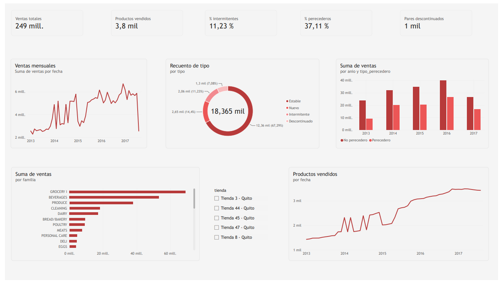

# Análisis de demanda, surtido e inventario — Corporación Favorita

Proyecto de análisis de ventas de supermercado con datos reales de Corporación Favorita (Ecuador). El objetivo es entender cómo cambia la demanda por producto a lo largo del tiempo, detectar patrones de surtido y preparar la base para un pronóstico que apoye decisiones de reabastecimiento. Incluye un dashboard en Power BI.

**Estado:** en desarrollo. Están listos la exploración, la limpieza, la clasificación de productos, la carga en SQL Server y el dashboard. El modelo de pronóstico está en la lista de próximos pasos.

---

## Datos

- **Fuente:** concurso *Corporación Favorita Grocery Sales Forecasting* (Kaggle).
- **Archivo principal:** `train.csv`, con ventas diarias por tienda y producto, del 2013-01-01 al 2017-08-15 (unas 125 millones de filas en total).
- **Archivos auxiliares:**
  - `items.csv`: familia, clase y si el producto es perecedero.
  - `stores.csv`: ciudad, estado, tipo y grupo de cada tienda.
  - `holidays_events.csv`, `oil.csv` y `transactions.csv`: no se usan todavía.
- **Muestra usada:** 5 tiendas (3, 8, 44, 45 y 47), con 17,117,188 filas.

Los datos no están incluidos en este repositorio por su tamaño. Ver `.gitignore`.

---

## Estructura

```
├── 01_explorar.py            # Exploración de una muestra de 1,000,000 filas
├── 02_limpieza_basica.py     # Conversión de fechas, nulos y conteos básicos
├── 03_filtrar.py             # Filtrado de 5 tiendas en bloques
├── 04_verificar.py           # Verificación del archivo filtrado
├── 05_cargar.py              # Carga de la tienda 3 a SQL Server
├── 05_grupo_productos.py     # Cruce del grupo de productos con items.csv
├── 06_comparar_tiendas.py    # Comparación de meses con ventas por tienda y producto
├── 07_preparar_dashboard.py  # Tablas resumidas y clasificación de productos para Power BI
├── dashboard/                # Tablas de salida y archivo de Power BI
│   ├── inventario.pbix
│   ├── ventas_mensuales.csv
│   ├── productos.csv
│   └── ventas_producto_mes.csv
├── data/                     # Archivos originales (no incluidos)
└── processed/                # Archivos filtrados (no incluidos)
```

---

## Procesamiento

1. **Exploración:** lectura de una muestra de 1,000,000 filas para revisar tipos de datos y el periodo cubierto.
2. **Limpieza básica:** conversión de `date` a fecha y conteo de tiendas y productos. La columna `onpromotion` está vacía en la parte inicial del archivo, así que no se usa todavía.
3. **Filtrado:** lectura de `train.csv` en bloques de 1,000,000 filas, conservando solo las 5 tiendas elegidas.
4. **Verificación:** el archivo filtrado tiene 17,117,188 filas, con fechas del 2013-01-02 al 2017-08-15.
5. **Carga a SQL Server:** la tienda 3 se cargó en la tabla `ventas` (3,401,264 filas) para hacer consultas SQL.
6. **Tablas para Power BI:** `07_preparar_dashboard.py` genera tres tablas resumidas, para que el dashboard no tenga que leer los 17 millones de filas.

---

## Clasificación de productos

Cada par tienda-producto se clasifica con esta regla, en orden de prioridad:

1. **Descontinuado:** su última venta fue antes de junio de 2017.
2. **Nuevo:** no tiene ningún año completo posterior a su primera venta, es decir, empezó a venderse en 2016 o después.
3. **Estable:** en cada año completo posterior a su primera venta, se vendió en al menos 7 meses (cobertura mínima de 0.6 o más).
4. **Intermitente:** en algún año completo posterior a su primera venta, se vendió en menos de 7 meses.

Los años que se evalúan son 2013 a 2016. La clasificación se hace por tienda, porque el inventario se maneja por tienda. Si se hiciera sobre todas las tiendas juntas, un hueco en una tienda quedaría oculto por las demás.

Resultado sobre las cinco tiendas (18,365 pares tienda-producto):

| Tipo | Pares | Porcentaje |
|---|---|---|
| Estable | 12,358 | 67.3 % |
| Nuevo | 2,645 | 14.4 % |
| Intermitente | 2,062 | 11.2 % |
| Descontinuado | 1,300 | 7.1 % |

---

## Hallazgos

### 1. Crecimiento de las ventas

En la tienda 3, las ventas mensuales pasan de unas 500 mil unidades en 2013 a más de 1 millón en 2016 y 2017.

### 2. Estacionalidad

Diciembre es el mes más fuerte en 2013, 2015 y 2016. En 2014 también hay picos en enero, marzo, julio y de septiembre a diciembre.

### 3. Meses altos y bajos en 2014

En 2014, las ventas mensuales alternan entre meses altos (por ejemplo, enero con 996 mil unidades) y meses bajos (febrero con 556 mil).

Todos los meses tienen el número completo de días con ventas, así que la diferencia no se debe a días faltantes. Se debe a la cantidad de productos distintos que se venden: en los meses altos se venden entre 2,200 y 2,400 productos, y en los bajos alrededor de 1,700. El promedio de unidades por fila se mantiene entre 13 y 18 en todos los meses.

### 4. Grupo de 472 productos con ventas intermitentes en 2014

Al contar en cuántos meses de 2014 se vendió cada producto en la tienda 3:

- **1,509 productos** se vendieron los 12 meses.
- **472 productos** se vendieron exactamente en los meses 1, 3, 7, 9, 10, 11 y 12, y en ningún otro.
- El resto son grupos pequeños, de entre 1 y 111 productos cada uno.

El mismo patrón aparece en la tienda 44: 476 productos se venden solo en esos siete meses, y 1,533 se venden todo el año.

Familias del grupo de 472 productos, comparadas con el catálogo completo (unos 4,100 productos):

| Familia | Dentro del grupo | Catálogo completo |
|---|---|---|
| PRODUCE | 174 (37 %) | 306 (7 %) |
| BEVERAGES | 130 (28 %) | 613 (15 %) |
| HOME CARE | 54 (11 %) | 108 (3 %) |
| GROCERY I | 8 (2 %) | 1,334 (33 %) |

Del grupo, 177 productos (37 %) son perecederos.

Este grupo no sale como "Intermitente" en la clasificación final, porque esa regla evalúa los años completos posteriores a la primera venta. Lo que muestra el análisis de 2014 es una caída de surtido en un año específico, y la clasificación mide el patrón a lo largo de los años.

### 5. El patrón de 2014 no se repite en 2015 ni en 2016

En 2015 y 2016 no aparece el grupo de 7 meses. Los patrones parciales más comunes son productos que empiezan a venderse a mitad de año, por ejemplo entre mayo y junio, y se mantienen hasta diciembre. Esto sugiere que se incorporan productos nuevos al surtido durante el año.

### 6. Crecimiento de los productos que se venden todo el año

| Año | Tienda 3 | Tienda 44 |
|---|---|---|
| 2014 | 1,509 | 1,533 |
| 2015 | 1,787 | 1,800 |
| 2016 | 2,671 | 2,723 |

---

## Dashboard de Power BI

El archivo `dashboard/inventario.pbix` tiene una página de resumen con estos elementos:

- **Tarjetas:** ventas totales, productos vendidos, % intermitentes, % perecederos y pares descontinuados.
- **Ventas mensuales:** línea de tendencia de 2013 a 2017.
- **Recuento de tipo:** dona con la distribución de estable, nuevo, intermitente y descontinuado.
- **Suma de ventas por año y tipo de perecedero:** columnas agrupadas.
- **Suma de ventas por familia:** barras horizontales.
- **Productos vendidos por fecha:** línea del número de productos distintos por mes.
- **Segmentación de tiendas:** filtra todos los visuales.

### Modelo de datos

- `productos[clave]` se relaciona con `ventas_producto_mes[clave]`.
- `stores[store_nbr]` se relaciona con `productos[store_nbr]` y con `ventas_mensuales[store_nbr]`.
- La relación entre `stores` y `ventas_producto_mes` está desactivada para evitar rutas ambiguas. El filtro llega a las ventas por medio de `productos`.

### Medidas principales

```dax
Ventas totales = SUM(ventas_producto_mes[ventas])
Productos vendidos = DISTINCTCOUNT(ventas_producto_mes[item_nbr])
Pares intermitentes = CALCULATE(COUNTROWS(productos), productos[tipo] = "Intermitente")
% intermitentes = DIVIDE([Pares intermitentes], COUNTROWS(productos))
Ventas perecederos = CALCULATE([Ventas totales], ventas_producto_mes[perecedero] = 1)
% perecederos = DIVIDE([Ventas perecederos], [Ventas totales])
Pares descontinuados = CALCULATE(COUNTROWS(productos), productos[tipo] = "Descontinuado")
```



---

## Limitaciones

- El análisis de productos intermitentes en 2014 cubre solo la tienda 3 y la 44, y es descriptivo.
- Solo se usaron 5 tiendas de las 54 del archivo completo.
- El conjunto de datos no incluye inventario ni quiebres de stock, así que no podemos medir esos eventos directamente.
- El conjunto de datos solo incluye filas con ventas. Los días sin venta no aparecen, así que no se puede distinguir un quiebre de una falta de demanda.
- Agosto de 2017 está incompleto: los datos terminan el 15 de ese mes.
- La columna de ventas en SQL Server es `FLOAT`, por lo que algunos totales tienen decimales de más. Para reportes conviene usar `ROUND` o `DECIMAL`.
- La tabla `ventas` en SQL Server solo tiene la tienda 3, así que las consultas SQL no reflejan las otras cuatro tiendas.

---

## Próximos pasos

1. Construir un pronóstico por familia con un modelo estacional (`statsmodels`), comparando al menos dos modelos.
2. Calcular punto de reorden e inventario de seguridad a partir del pronóstico.
3. Tratar por separado los productos nuevos, con poca historia, y los intermitentes.
4. Revisar la columna `onpromotion` con el archivo de prueba antes de usarla.

---

## Cómo reproducirlo

**Requisitos:** Python 3.11, `pandas`, `numpy`, `sqlalchemy`, `pyodbc`, SQL Server Express, ODBC Driver 18 for SQL Server y Power BI Desktop.

Ejecuta los scripts en el orden de la sección de estructura, desde la raíz del proyecto. Los archivos originales deben estar en `data/`. Después abre `dashboard/inventario.pbix` en Power BI Desktop y actualiza los datos.

---

## Autor

Adonis Fajardo
